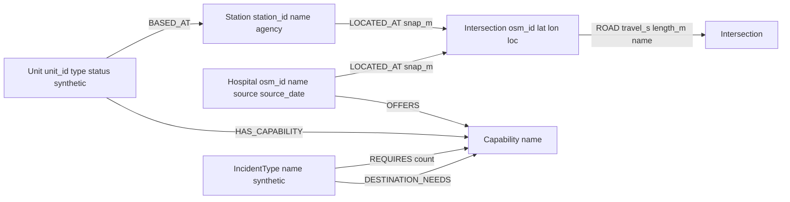

# GraphDispatch - Project Brief

Graph Hacks (WeMakeDevs x FalkorDB), Tracks 01 and 02.

## Stack
- Python 3.12, falkordb-py
- FalkorDB in Docker for dev
- FastAPI + Next.js later, not now

## Decisions
- networkx is a test-only oracle and must never be imported by runtime code.
- All Cypher is parameterized, never f-strings.
- Indexes are created before bulk loads.
- Map box is B2 (W -121.945 S 37.300 E -121.840 N 37.370), largest strongly connected component only (4,213 intersections).
- graphdispatch/db.py is the only module that talks to FalkorDB; every runtime query is named in graphdispatch/queries.cypher.
- Hospitals are matched by osm_id, never by name (O'Connor's OSM name has a curly apostrophe).
- Units and incident types are synthetic and labeled so (synthetic:true, "# synthetic" in the seed headers).
- Routing is algo.SPpaths on travel_s; AStar is not used.
- Unit assignment is greedy, scarcest capability first (fewest available candidate units, ties by name), fastest units first, a unit counted once.
- Hospital choice: fastest ETA among hospitals that OFFER the destination capability; the nearest hospital of any kind is reported with the reason it was skipped.
- Incidents more than 500 m from the nearest intersection raise OutOfArea.
- Hospital capabilities come from seed/hospitals.csv (sources and dates recorded per row); OSM operator tags are not used.

## Pitfalls
- Verify engine behavior on a live FalkorDB before relying on researched claims.
- Check the installed osmnx bbox argument order before calling graph_from_bbox (2.x: one tuple of left, bottom, right, top).
- Use py -3.12 for the venv; the default python on this machine is 3.10.
- Call algo.SPpaths with a single config map and a pathCount; algo.AStar takes one argument (a config map), not (source, target, config).
- GRAPH.MEMORY USAGE reports whole MB (0 for small graphs); use INFO memory used_memory deltas for small graphs.
- algo.AStar takes one config map and requires latitudeProperty and longitudeProperty (not latitudeProp). With weightProp travel_s it returned suboptimal paths (1/20 match); do not use it for routing without re-verification. dbms.procedures() returns only name and mode, no signatures.
- Reading OSM features and drive graphs for the large box takes minutes; run in background.
- Engine default query TIMEOUT is 1000 ms (FalkorDB 4.22.1 module).
- The downtown San Jose bbox yields 874 intersections, below the 1,000 floor; revisit the bbox before relying on it.

## Graph model (graph "sjfd")

## Phase 1 pitfalls
- point() and distance() work on FalkorDB 4.22.1 (distance in meters, float32 precision).
- In osmnx 2.1.1 the SCC function is ox.truncate.largest_component(G, strongly=True).
- B2 SCC cut drops 103 nodes; CSV export also drops 42 parallel edges.
- OSM operator tags are stale: Regional shows HCA and O'Connor shows Verity Health, both are county-run now. Do not trust them.
- scripts/load.py reads hospital coordinates from data/processed/hospitals_raw.csv (gitignored), so run Phase 0B fetch_pois.py first on a fresh clone.
- Long multi-file shell heredocs failed once in this shell; write files with the editor tool.

## Anti-features
- Voice input
- Multilingual intake
- Auth/accounts
- Full Bay Area road network
- Graphiti/Cognee as memory layer
- Mobile apps
- Real 911 or personal data

## Privacy
- Synthetic and public OSM data only. No personal data, no real emergency traffic, no keys in tracked files.