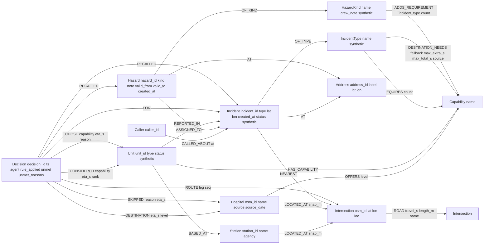
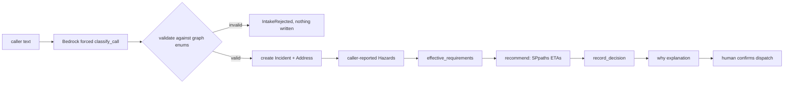

# GraphDispatch - Project Brief

Graph Hacks (WeMakeDevs x FalkorDB), Tracks 01 and 02.

## Stack
- Python 3.12, falkordb-py
- FalkorDB in Docker for dev
- FastAPI + Next.js later, not now

## Decisions
- networkx is a test-only oracle and must never be imported by runtime code.
- All Cypher is parameterized, never f-strings.
- Indexes are created before bulk loads.
- Map box is B2 (W -121.945 S 37.300 E -121.840 N 37.370), largest strongly connected component only (4,213 intersections).
- graphdispatch/db.py is the only module that talks to FalkorDB; every runtime query is named in graphdispatch/queries.cypher.
- Hospitals are matched by osm_id, never by name (O'Connor's OSM name has a curly apostrophe).
- Units and incident types are synthetic and labeled so (synthetic:true, "# synthetic" in the seed headers).
- Routing is algo.SPpaths on travel_s; AStar is not used.
- Unit assignment is greedy, scarcest capability first (fewest available candidate units, ties by name), fastest units first, a unit counted once.
- Hospital choice: fastest ETA among hospitals that OFFER the destination capability; the nearest hospital of any kind is reported with the reason it was skipped.
- Incidents more than 500 m from the nearest intersection raise OutOfArea.
- LLM provider for Phase 3 will be Amazon Bedrock behind an adapter (nothing LLM-related exists yet).
- Graph name comes from env GRAPH_NAME (default sjfd). Tests use sjfd_test, dropped and reloaded from seed/ at session start; tests never write to sjfd.
- scripts/load.py reads ONLY from seed/ (road snapshot seed/osm_b2_<date>/); build_roads.py writes a new snapshot folder only with --refresh.
- All reads go through db.read (GRAPH.RO_QUERY); writes through db.write. recommend() is read-only.
- why(decision_id) is ONE Cypher query. dispatch(decision_id) is ONE query: units flip to assigned only if all chosen units are available, else no rows and no change. Dispatch is human-confirmed; run_call never dispatches.
- Stroke destination rule lives on the stroke DESTINATION_NEEDS edge (fallback, max_extra_s, max_total_s, source) and is applied by the pure function rules.stroke_bypass.
- Timestamps are epoch seconds (int). Address id is the label lowercased with whitespace collapsed. Recall window is 30 days; hazards recalled when valid_from <= now <= valid_to.
- Acceptance rule: no networkx under graphdispatch/ or scripts/ (tests/ and the phase0 probe are exempt).
- Deployment: one EC2 t3.micro running docker compose (app + FalkorDB), plain HTTP first. Bedrock access comes from the EC2 INSTANCE ROLE through the default boto3 credential chain: there are no AWS keys on the host, in .env.server or in the image. The role's policy (deploy/iam-bedrock-policy.json) allows only bedrock:InvokeModel on the Haiku 4.5 US inference profile and its three regional model ARNs. The daily LLM cap (runs/llm_daily.json on a named volume) is the real cost guard.
- Design rule: the LLM never writes Cypher. It may only output values from enums derived from the graph (IncidentType names, HazardKind names), via forced tool calls whose schemas are built at runtime from the graph. The caller text is data, not instructions.
- LLM provider: Amazon Bedrock Converse API behind graphdispatch/llm.py (region us-east-1; model us.anthropic.claude-haiku-4-5-20251001-v1:0, chosen because Haiku 5.5 returned AccessDeniedException for this account). Hard cap LLM_CALL_CAP calls per process (default 20). Credentials live only in the gitignored .env or the AWS chain; never printed or committed.
- Address ids are normalized (lowercase, punctuation stripped, whitespace collapsed, last word abbreviated via seed/address_suffixes.csv), so "200 Demo Street" and "200 demo st." are one Address. Device-derived labels are "device@<lat 4dp>,<lon 4dp>".
- LLM intake (graphdispatch/intake.py): text -> one forced classify_call -> validation against the graph's enums in code (IntakeRejected, nothing written) -> create incident (call_text and intake_model stored, synthetic) -> caller-reported hazards written as Hazard {reported_by:'caller'} -> effective_requirements -> recommend -> record_decision. Never dispatches. The model's confidence is uncalibrated (0.95 everywhere in the 4A probe) and is neither stored nor shown.
- MCP (graphdispatch/tools.py + mcp_server.py, SDK package `mcp` 2.3.0): exactly six tools; five are read-only and report_hazard is the only write. There is no dispatch tool, no clear tool and no tool that takes Cypher or free query text. Dispatch stays human-confirmed (CLI/ops).
- Memory changes decisions: requirements for an incident are the type's REQUIRES plus ADDS_REQUIREMENT from active hazards at the same Address whose incident_type matches (query effective_requirements, one query). Summing rule: sum across base and DISTINCT hazard kinds; repeated hazards of one kind never add up (group by capability and kind, take the max count per kind). Sources list each kind once with all contributing hazard ids. Summing rule: sum across base and DISTINCT hazard kinds; repeated hazards of one kind never add up (group by capability and kind, take the max count per kind). Sources list each kind once with all contributing hazard ids. Summing rule: sum across base and DISTINCT hazard kinds; repeated hazards of one kind never add up (group by capability and kind, take the max count per kind). Sources list each kind once with all contributing hazard ids. Each CHOSE edge records why the capability was required ('base' or 'hazard:<id>:<kind>'). Unmet capabilities are stored on the Decision (unmet, unmet_reasons); a shortage never crashes a call.
- Hazard kinds are a closed vocabulary (HazardKind from seed/hazard_rules.csv); add_hazard refuses unknown kinds and lists the allowed ones.
- Trauma levels come from the CA EMSA Designated Trauma Centers list (updated 2025-08-25) and are stored as OFFERS {level}; they are displayed, never used to choose a hospital.
- Runtime labels are Incident, Decision, Caller, Address, Hazard. scripts/reset.py is the only reset path: dry run by default, --yes only for sjfd or sjfd_test, deletes runtime labels only and restores seed unit statuses.
- Tests write outputs to runs/ (gitignored); a full test run must leave git status clean.
- Hospital capabilities come from seed/hospitals.csv (sources and dates recorded per row); OSM operator tags are not used.

## Pitfalls
- Verify engine behavior on a live FalkorDB before relying on researched claims.
- Check the installed osmnx bbox argument order before calling graph_from_bbox (2.x: one tuple of left, bottom, right, top).
- Use py -3.12 for the venv; the default python on this machine is 3.10.
- Call algo.SPpaths with a single config map and a pathCount; algo.AStar takes one argument (a config map), not (source, target, config).
- GRAPH.MEMORY USAGE reports whole MB (0 for small graphs); use INFO memory used_memory deltas for small graphs.
- algo.AStar takes one config map and requires latitudeProperty and longitudeProperty (not latitudeProp). With weightProp travel_s it returned suboptimal paths (1/20 match); do not use it for routing without re-verification. dbms.procedures() returns only name and mode, no signatures.
- Reading OSM features and drive graphs for the large box takes minutes; run in background.
- Engine default query TIMEOUT is 1000 ms (FalkorDB 4.22.1 module).
- The downtown San Jose bbox yields 874 intersections, below the 1,000 floor; revisit the bbox before relying on it.

## Graph model (graph "sjfd")

ASSIGNED_TO (Unit to Incident) is an addition beyond the original spec, so clear() frees only units dispatched to that incident.

## Phase 1 pitfalls
- point() and distance() work on FalkorDB 4.22.1 (distance in meters, float32 precision).
- In osmnx 2.1.1 the SCC function is ox.truncate.largest_component(G, strongly=True).
- B2 SCC cut drops 103 nodes; CSV export also drops 42 parallel edges.
- OSM operator tags are stale: Regional shows HCA and O'Connor shows Verity Health, both are county-run now. Do not trust them.
- scripts/load.py reads hospital coordinates from data/processed/hospitals_raw.csv (gitignored), so run Phase 0B fetch_pois.py first on a fresh clone.
- Long multi-file shell heredocs failed once in this shell; write files with the editor tool.

## Phase 4B pitfalls
- mcp 2.x is not the 1.x API: use mcp.server.lowlevel.Server with on_list_tools/on_call_tool callbacks (FastMCP was renamed MCPServer); Tool fields are snake_case (input_schema, is_error).
- Nothing but protocol messages may go to stdout in the MCP server.
- Run `pip install -e .` once; scripts and probes then import graphdispatch from anywhere.
- Same-second incidents/hazards need an insertion-order tie-break (id()) or recall order is random.
- Bash heredocs containing quotes and fences fail intermittently in this shell; write files with the editor tool.

## Phase 3 pitfalls
- A graph is created as a side effect of select_graph + any query (phase0/probe_procs.py left an empty probe_procs graph).
- Hazards created before HazardKind existed have no OF_KIND edge and are ignored by effective_requirements.
- Seed hospitals.csv source text contains commas; the field is quoted.

## Phase 2 pitfalls
- ro_query works with CALL algo.SPpaths; use it for all reads.
- OPTIONAL MATCH + collect({...}) returns one all-null map when nothing matches; filter in Python. UNWIND over an empty list drops all rows, so skip empty writes.
- record_decision is several write queries (not one transaction); a crash mid-way can leave a partial decision.
- Test helper queries (wipe_runtime, set_unit_status) live in queries.cypher; drop_graph and wipe are guarded to *_test graphs only.
- Fresh clone: python scripts/load.py (with GRAPH_NAME set) needs only seed/ and a running FalkorDB.

## Pipeline (Phase 4B)


## Claude Desktop MCP config (do not paste into the config automatically)
Add under `mcpServers` in `claude_desktop_config.json`; the venv python is launched by absolute path:
```json
{
  "mcpServers": {
    "graphdispatch": {
      "command": "[repo]\\.venv\\Scripts\\python.exe",
      "args": ["-m", "graphdispatch.mcp_server"],
      "env": { "GRAPH_NAME": "sjfd_test" }
    }
  }
}
```
FalkorDB must be running on localhost:6379. Use GRAPH_NAME sjfd for the real demo graph.

## Web app (Phase 5)
Run: `python -m uvicorn graphdispatch.api:app --port 8000` (graph from env GRAPH_NAME, default sjfd; FalkorDB on localhost:6379). Open http://localhost:8000/.
- API (graphdispatch/api.py): GET /api/health (real graph read, 503 if FalkorDB is down), GET /api/meta, POST /api/call (the only LLM path), POST /api/recommend (graph only), GET /api/decision/{id}, POST /api/dispatch/{decision_id}, POST /api/clear/{incident_id}, GET /api/incidents, POST /api/hazard. Interactive docs at /api/docs.
- Every decision response carries `routes` ([lon, lat] arrays per leg, from the ROUTE edges) and `queries` (name, real Cypher text, ms, summarized params) for every named query the request ran; db.record_queries() collects them.
- Cost control for a public URL: /api/call is capped server-side by LLM_DAILY_CAP (env, default 150, counted by UTC date in runs/llm_daily.json) and 6 calls per 10 minutes per client IP (TRUST_PROXY=1 only behind CloudFront or a load balancer: it then counts the CloudFront-Viewer-Address header with the port stripped, else the RIGHTMOST X-Forwarded-For entry, never the client-supplied leftmost ones; with TRUST_PROXY=0 forwarding headers are ignored). Over a cap the API returns 429 and the page switches to Graph only. The graph-only path never calls the LLM. Caller ids are generated server-side.
- Static page (graphdispatch/static/): index.html, app.js, api.js, map.js, panel.js, style.css as plain ES modules, no build step. MapLibre GL JS 5.24.0 is vendored in static/vendor/ (source recorded in seed/DATA.md). Runtime network: the tile server (tiles.openfreemap.org) and Google Fonts only.
- Design: NFPA 704 placard colors carry meaning (fire red for units and stations, medical blue for hospitals, hazard yellow for hazard shapes only, never as text). Tokens in style.css: ink #1D2733, muted #5E6B7A, surface #F2F4F6, panel #FFFFFF, fire #C8102E, medical #1F5FBF, hazard #F2C230, line #D5DBE1. Atkinson Hyperlegible Next for UI, Atkinson Hyperlegible Mono only for unit ids, ETAs and Cypher. Sentence case, one 6 px control radius, visible focus, reduced motion respected.
- The memorable element: every line in the decision panel is a button that opens the Why drawer on the Cypher query that produced it, with its parameters and timings.
- Graph-only "Garage fire with oxygen" preset records the oxygen hazard first (what the AI path extracts from call 1), then runs structure_fire, then cardiac_arrest. Adding the hazard between the two calls, as first specified, would never change either call because oxygen_storage only adds hazmat to structure_fire.
- Plain language (Phase 5B): the panel uses seed/capability_labels.csv and seed/incident_type_labels.csv (served in /api/meta as `labels`) and m:ss times (551 s is 9:11). The Why drawer keeps raw ids, seconds and Cypher. The panel's rule sentence is rendered from numbers in `rule`, which api.parse_rule derives from the sentence rules.py writes (tests call rules.stroke_bypass for both branches, so a wording change fails a test); the full rule_applied string stays in the Why drawer.
- Map follows the decision: every decision render fits the map to the incident, the stations used, the chosen hospital, the nearest skipped hospital and every route point, with padding that clears the legend (top left) and the controls. The chosen hospital is a filled blue marker, other hospitals are outlined, and the nearest skipped hospital has a grey ring and a short label ("Nearest, skipped: no clot removal"). Only one location marker is ever shown (caller pin before a decision, incident ring after).
- Visual check: run a server on a free port with GRAPH_NAME=sjfd_test, then `SCREENSHOT_URL=http://localhost:8001/ python phase5/screenshots.py`; it refuses any server whose graph is not sjfd_test and asserts the geometry, one-marker and plain-text rules.
- Screenshots and the console/network check: `python phase5/screenshots.py` with the server running on GRAPH_NAME=sjfd_test (needs `pip install playwright pillow` and `playwright install chromium`); outputs in phase5/screens/.

## Phase 5 pitfalls
- The operator may already have a server on port 8000 (graph sjfd). Never test against it; use another port.
- A local variable named like a module function (labels) shadows it inside the same function.
- Author CSS `display` overrides the `hidden` attribute; keep `[hidden] { display: none !important; }`.
- MapLibre writes an inline `transform` on marker elements, so style marker shapes with pseudo-elements, not transform on the marker. Plain `div` markers need `display: block` after `all: unset`.
- A hazard at the incident's own coordinates hides under the incident pin; hazard markers are offset 20 px.
- Palette-compressing screenshots with median cut turns small saturated shapes (the yellow diamond) tan; use FASTOCTREE.
- uvicorn runs sync endpoints in a thread pool; db.record_queries() uses a ContextVar so recordings do not mix between requests.

## Deploy (Phase 6A)
- Files: Dockerfile (python:3.12-slim, non-root user, runtime deps pinned in requirements-runtime.txt, only graphdispatch/, seed/ and scripts/load.py copied), deploy/docker-entrypoint.sh (waits for FalkorDB, runs the idempotent scripts/load.py, then uvicorn with exactly 1 worker), docker-compose.yml (falkordb pinned by digest with no published ports, a named volume at /var/lib/falkordb/data, healthcheck, 300 MB limit; app on port 80, 450 MB limit, runs volume), docker-compose.local.yml (app on 8080), .env.server.example (no AWS key lines), deploy/iam-bedrock-policy.json, deploy/ship.sh (dry run by default), deploy/RUNBOOK.md (operator-only AWS checklist).
- Local proof: `docker compose -p gdlocal -f docker-compose.yml -f docker-compose.local.yml up -d --build` with a local .env.server (LLM_DAILY_CAP=0), then `python phase6a/smoke.py http://localhost:8080 --calls 20`; tear down with `docker compose -p gdlocal down -v` (project gdlocal only; never touch falkordb-dev).
- Self-healing demo: a background task (every DEMO_EXPIRY_INTERVAL_S, default 300, and once at startup) expires incidents that are open or dispatched and older than DEMO_EXPIRE_MIN (default 30): status 'expired', assigned units back to 'available' (their seed status). Hazards, decisions and callers are kept so memory still works.
- ship.sh ships only `git archive HEAD`, so no local .env can leave the machine; it never copies an env file from this machine (the host keeps its own ~/graphdispatch/.env.server). Never run it with --yes without the operator.

## Phase 6A pitfalls
- FalkorDB's image declares no volume; mount one at /var/lib/falkordb/data yourself or data dies with the container. Give it stop_grace_period so Redis can write its snapshot on shutdown.
- .dockerignore patterns match only at the context root: use **/__pycache__.
- On Windows `bash` on PATH may be WSL's; tests look for Git Bash.
- docker compose list fields append across -f files; use `!override` to replace ports.
- The app code resolves seed/ and runs/ relative to the package, so the image installs it editable at /app (not into site-packages).

## QUERIES
Every named query in graphdispatch/queries.cypher (kept in sync by tests/test_docs.py):
- `idx_intersection`: Index Intersection.osm_id.
- `idx_unit`: Index Unit.unit_id.
- `idx_station`: Index Station.station_id.
- `idx_hospital`: Index Hospital.osm_id.
- `idx_capability`: Index Capability.name.
- `idx_incident_type`: Index IncidentType.name.
- `idx_incident`: Index Incident.incident_id.
- `idx_address`: Index Address.address_id.
- `idx_caller`: Index Caller.caller_id.
- `idx_hazard`: Index Hazard.hazard_id.
- `idx_decision`: Index Decision.decision_id.
- `load_intersections`: Batch-merge intersections with a geo point.
- `load_roads`: Batch-merge directed ROAD edges.
- `load_capabilities`: Merge capability vocabulary nodes.
- `load_stations`: Merge stations.
- `load_hospitals`: Merge hospitals (matched by osm_id, never by name).
- `load_offers`: Link hospitals to the capabilities they offer, with an optional designation level.
- `load_units`: Merge synthetic units and their base station.
- `load_unit_caps`: Link units to their capabilities.
- `load_incident_types`: Merge synthetic incident types.
- `load_requires`: Link incident types to required capabilities with counts.
- `load_dest_needs`: Link incident types to the destination capability, with optional bypass-rule properties (null props are skipped).
- `snap_station`: Snap a station to its nearest intersection and store snap_m.
- `snap_hospital`: Snap a hospital to its nearest intersection and store snap_m.
- `count_labels`: Node counts per label.
- `count_rels`: Relationship counts per type.
- `snap_report`: Snap distances for every station and hospital.
- `snap_incident`: Nearest intersection to an incident location and the snap distance in meters.
- `unit_candidates`: Multi-hop: required capabilities to available units, their station and station intersection.
- `required_caps`: Capabilities (with counts) an incident type requires, including those no available unit has.
- `dest_capability`: Destination capability and optional fallback rule for an incident type (no row if none).
- `hospitals`: Every hospital with its intersection, offered capabilities and designation levels.
- `eta`: Travel time in seconds along the cheapest outgoing path between two intersections via SPpaths.
- `route`: Cheapest outgoing path between two intersections via SPpaths: weight and ordered node ids.
- `create_incident`: Create a synthetic incident with its caller, address and nearest intersection (call_text and intake_model are set only for LLM intake).
- `incident_info`: Incident status, type and address.
- `recall_incidents`: Earlier incidents at the same address since a cutoff time.
- `recall_hazards`: Hazards at the incident's address that are valid at the given time, with the kind's crew note.
- `add_hazard`: Create a hazard of a known kind at an address (address created with label, and position when given).
- `hazard_reported_in`: Link a hazard to the incident it was reported in.
- `decision_create`: Create a decision node for an incident, with unmet capabilities and their reasons.
- `decision_considered`: Record candidate units considered, with capability, ETA and rank.
- `decision_chose`: Record chosen units with the capability they cover, ETA and why the capability was required.
- `decision_destination`: Record the chosen destination hospital, ETA and designation level.
- `decision_skipped`: Record hospitals skipped, with reason and ETA.
- `decision_route`: Record route path nodes per leg in order.
- `decision_recalled_hazards`: Record hazards surfaced to this decision.
- `decision_recalled_incidents`: Record earlier incidents surfaced to this decision.
- `why`: Everything recorded for one decision, in a single query.
- `decision_units`: Units chosen by a decision with their current status.
- `dispatch`: All-or-nothing dispatch: assign the chosen units and mark the incident dispatched only if every chosen unit is available.
- `clear`: Return an incident's assigned units to available and mark the incident cleared.
- `set_unit_status`: Administrative/test helper: set one unit's status.
- `wipe_runtime`: Test helper: delete all runtime nodes (incidents, callers, addresses, hazards, decisions).
- `unit_statuses`: Every unit with its current status.
- `assigned_to_count`: Number of ASSIGNED_TO relationships (test helper).
- `idx_hazard_kind`: Index HazardKind.name.
- `load_hazard_kinds`: Merge synthetic hazard kinds with their crew notes.
- `load_hazard_adds`: Link hazard kinds to capabilities they add for an incident type.
- `hazard_kinds`: List allowed hazard kinds.
- `effective_requirements`: Incident type requirements plus requirements added by active hazards at the incident's address; hazards are grouped by (capability, kind) taking the max count per kind, so repeated hazards of one kind never double count.
- `runtime_label_counts`: Node counts for runtime labels only (reset dry run).
- `runtime_rel_counts`: Relationship counts for relationships touching runtime labels (reset dry run).
- `seed_label_counts`: Node counts for non-runtime (seed) labels.
- `seed_rel_counts`: Relationship counts for relationships between seed labels only.
- `incident_type_names`: List incident type names (enum source for LLM tools).
- `address_hazards`: Active hazards at an address (by normalized address_id) with crew notes.
- `address_incidents`: Incidents at an address (by normalized address_id) created since a cutoff time.
- `open_incidents`: Incidents that are open or dispatched, with their address.
- `unit_status_detail`: Every unit with type, status and station.
- `health_ping`: Health check: count intersections (a real graph read).
- `meta_stations`: Stations with the position of the intersection they snap to.
- `meta_hospitals`: Hospitals with snapped position, offered capabilities and designation levels.
- `active_hazards_map`: Active hazards with the address position and crew note (for map markers).
- `expire_incidents`: Demo self-healing: expire open or dispatched incidents created before a cutoff and free the units assigned to them (decisions and hazards are kept).

## Anti-features
- Voice input
- Multilingual intake
- Auth/accounts
- Full Bay Area road network
- Graphiti/Cognee as memory layer
- Mobile apps
- Real 911 or personal data

## Privacy
- Synthetic and public OSM data only. No personal data, no real emergency traffic, no keys in tracked files.